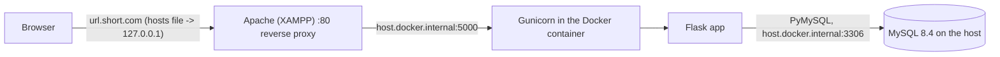

# URL Shortener (CSC 203)

Author: Daniel S. | Date: 11/25/2026 | Version: V1.0

A small URL shortener. Pick a user, paste a long URL, and get a short link
like `http://url.short.com/aB12cD` (random) or `http://url.short.com/my-alias`
(custom). Opening the short link redirects to the long URL. The home page
lists the current user's links with a Delete button.

## Architecture

| Piece | What it does here |
|---|---|
| Python + Flask | The web app: pages, forms, redirects (`app/`) |
| MySQL 8.4 (on the host) | Stores users and links (`app/schema.sql`) |
| Gunicorn | Production WSGI server, settings in `gunicorn_config.py` |
| Docker | Packages the app with Gunicorn (`Dockerfile`, `compose.yaml`) |
| Apache (XAMPP) | Reverse proxy for the `url.short.com` domain |

## Repo Layout

| Path | What's in it |
|---|---|
| `url_shortener.py` | Entry point, `flask --app url_shortener` and `url_shortener:app` |
| `app/` | Flask code: config, database, users, URLs, routes, redirect, templates |
| `tests/` | `unittest` unit tests, MySQL mocked, no database needed |
| `docs/README.md` | Index of every spec sheet with flow charts |
| `docs/specs/` | One spec sheet per feature (inputs, outputs, behavior, Mermaid charts) |
| `docs/demo-checklist.md` | The live demo, step by step, tier by tier |
| `make_submission.py` | Builds the eLearning zip without `.venv` or `.env` |

## Quick Start (Windows, VS Code)

1. `python -m venv .venv` then `.venv\Scripts\Activate.ps1`
2. `pip install -r requirements.txt`
3. Copy `.env.example` to `.env` and fill in the MySQL user and password
   (MySQL setup: [docs/specs/host-mysql.md](docs/specs/host-mysql.md)).
4. `flask --app url_shortener init-db` (creates the tables)
5. Unit tests: `python -m unittest`
6. Run locally: `$env:MYSQL_HOST="127.0.0.1"`, `$env:SITE_URL="http://127.0.0.1:5000"`,
   then `flask --app url_shortener run` and open `http://127.0.0.1:5000/`
7. Run in Docker: `docker compose up --build -d`, then `http://127.0.0.1:5000/`
8. Through Apache: add `127.0.0.1 url.short.com` to the hosts file, set up the
   XAMPP virtual host, then open `http://url.short.com`

The full demo walkthrough, including Gunicorn on its own and the Apache
setup, is in [docs/demo-checklist.md](docs/demo-checklist.md).

## AI Use

Claude (AI) was used to help write the code, tests and documentation in this
repo, working from the course spec and the project's Jira tickets.
