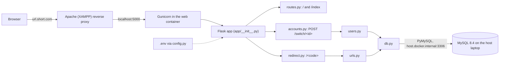
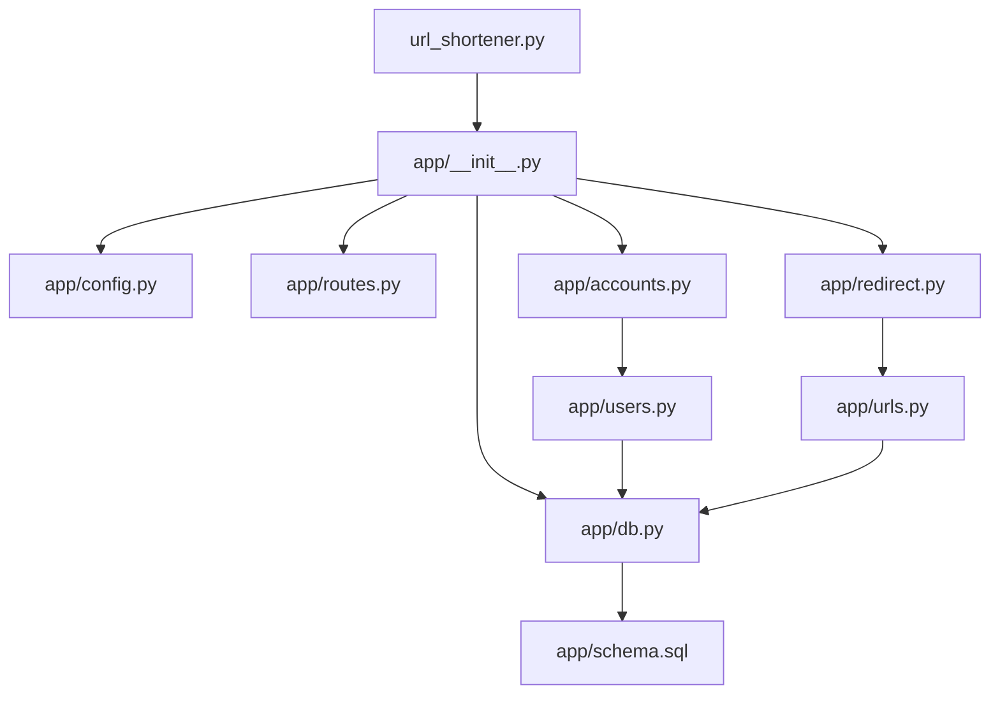

# URL Shortener Documentation

Author: Daniel S. | Date: 11/11/2026 | Version: V1.0

Every piece of functionality in the app has a spec sheet in `docs/specs/`
with its inputs, outputs, behavior, function reference, tests, known limits
and one or more Mermaid flow charts. Mermaid renders on GitHub and in VS Code
(with the "Markdown Preview Mermaid Support" extension).

## Spec Sheets

| Feature | Jira | Spec sheet | Code |
|---|---|---|---|
| App startup, config, Gunicorn, Docker | URL-4 | [app-startup.md](specs/app-startup.md) | `url_shortener.py`, `app/__init__.py`, `app/config.py`, `gunicorn_config.py`, `Dockerfile`, `compose*.yaml` |
| Host MySQL (database outside the container) | URL-29 | [host-mysql.md](specs/host-mysql.md) | `compose.yaml`, `.env.example` |
| Database connection and `flask init-db` | URL-9, URL-10 | [database.md](specs/database.md) | `app/db.py`, `app/schema.sql` |
| Users (usernames, no passwords) | URL-9 | [users.md](specs/users.md) | `app/users.py` |
| URLs (short codes, links) | URL-10 | [urls.md](specs/urls.md) | `app/urls.py` |
| Short link redirect | URL-11 | [redirect.md](specs/redirect.md) | `app/redirect.py` |
| User swapping | URL-12 | [user-swap.md](specs/user-swap.md) | `app/accounts.py` |
| User picker (switch or add a user) | URL-13 | [user-picker.md](specs/user-picker.md) | `app/templates/base.html`, `app/routes.py`, `app/accounts.py` |
| Create short link form (with custom alias) | URL-14, URL-22 | [create-form.md](specs/create-form.md) | `app/routes.py`, `app/templates/home.html` |
| Home page (list of links, Delete) | URL-15 | [home-page.md](specs/home-page.md) | `app/routes.py`, `app/templates/home.html` |

## How It All Fits Together

## Module Dependencies

## Running the Unit Tests

All tests are `unittest` unit tests with MySQL mocked, so no database is
needed.

* Terminal (from the repo folder, venv active): `python -m unittest -v`
* One file: `python -m unittest tests.test_urls -v`
* VS Code: open the Testing panel (flask icon). `.vscode/settings.json`
  already points it at `./tests` with the `test_*.py` pattern.

## Comment Style

Every file follows the style from the CPE-490 repo: a header block (Author,
Date, File, Version, Description), dashed banner sections (Imports,
Constants, Classes, Functions, Routes), a docstring per function with
`Arg1 = ...` and `Returns: ...`, and short Capitalized trailing comments on
lines that need them. Each file's header names its spec sheet.
