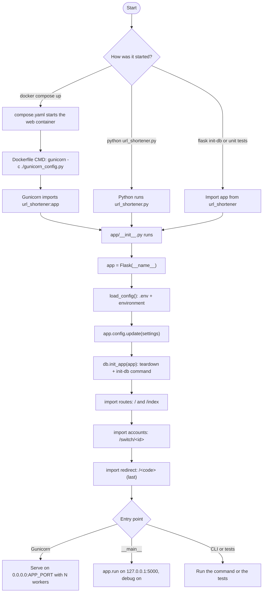
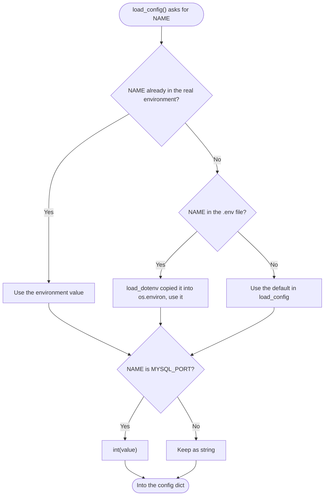

# Spec Sheet: App Startup, Config, Gunicorn and Docker

| | |
|---|---|
| **Author** | Daniel S. |
| **Date** | 11/11/2026 |
| **Version** | V1.1 |
| **Jira** | URL-4 (Infra epic), Gunicorn work merged in PR #1 |
| **Course spec** | PRE-4, WSGI-1 to WSGI-5, DOC-1 to DOC-7, DB-2, DB-5 |
| **Files** | `url_shortener.py`, `app/__init__.py`, `app/config.py`, `gunicorn_config.py`, `Dockerfile`, `compose.yaml`, `compose.dev.yaml`, `.env.example` |
| **Tests** | `tests/test_config.py`, `tests/test_gunicorn_config.py` |

## 1. Purpose

Gets the Flask app built, configured and served. This covers every way the
app can start: Gunicorn inside Docker (the real way, for the demo), the Flask
dev server on the laptop, the `flask init-db` command, and the unit tests.
All four end up with the same `app` object from `app/__init__.py`.

## 2. Inputs

| Input | Where it comes from | Used by | Default if missing |
|---|---|---|---|
| `MYSQL_HOST` | env var or `.env` | `app/config.py` -> `app/db.py` | `host.docker.internal` |
| `MYSQL_PORT` | env var or `.env` | same | `3306` (turned into an int) |
| `MYSQL_USER` | env var or `.env` | same | `""` |
| `MYSQL_PASSWORD` | env var or `.env` | same | `""` |
| `MYSQL_DB` | env var or `.env` | same | `url_shortener` |
| `SECRET_KEY` | env var or `.env` | Flask session signing | `dev-only-not-secret` |
| `APP_PORT` | env var | `gunicorn_config.py` | `5000` |
| `GUNICORN_WORKERS` | env var | `gunicorn_config.py` | `(2 x CPU cores) + 1` |

**Priority rule:** a real environment variable always beats the `.env` file,
because `load_dotenv(override=False)` never replaces a name that is already set.

## 3. Outputs

* A Flask `app` object with `app.config` holding the six settings above,
  the database hooked in, and every route registered.
* Gunicorn listening on `0.0.0.0:<APP_PORT>` with access logs on stdout and
  error logs on stderr (seen with `docker logs url_shortener_web`).
* One container from `docker compose up --build -d`: `url_shortener_web`
  (port 5000). MySQL is not a container, it runs on the host laptop on port
  3306 (DB-1, URL-29). See the [host MySQL spec sheet](host-mysql.md).

## 4. Behavior

1. **Import `app`.** Anything that runs `from app import app` triggers
   `app/__init__.py` the first time.
2. **Make the Flask object.** `app = Flask(__name__)`.
3. **Load settings.** `load_config()` reads `.env`, then builds the config
   dict from `os.environ` with defaults. `app.config.update()` stores it.
4. **Hook in the database.** `db.init_app(app)` registers `close_db` to run
   after every request and adds the `flask init-db` command.
5. **Register routes, in order.** `routes` (`/`, `/index`), then `accounts`
   (`/switch/<id>`), then `redirect` (`/<code>`) last so it never hides a
   fixed page.
6. **Serve.** Either Gunicorn reads `gunicorn_config.py` and serves
   `url_shortener:app`, or `python url_shortener.py` runs the dev server on
   `127.0.0.1:5000` with debug on.

## 5. Function and Setting Reference

| Name | File | Arg(s) | Returns / Effect |
|---|---|---|---|
| `load_config(env_file=None)` | `app/config.py` | path to a `.env`, or None to search | dict of the six settings. Raises `ValueError` if `MYSQL_PORT` isn't a number |
| `bind` | `gunicorn_config.py` | | `"0.0.0.0:<port>"` (WSGI-3, WSGI-4) |
| `workers` | `gunicorn_config.py` | | int, `(2 x cores) + 1` unless `GUNICORN_WORKERS` is set |
| `wsgi_app` | `gunicorn_config.py` | | `"url_shortener:app"` (WSGI-2) |
| `accesslog` / `errorlog` | `gunicorn_config.py` | | `"-"` = stdout / stderr (DOC-6) |

## 6. Flow Chart: Startup

## 7. Flow Chart: Where One Setting Comes From

## 8. Tests

* `tests/test_config.py`: defaults, reading a temporary `.env` file, and the
  real environment winning over `.env`.
* `tests/test_gunicorn_config.py`: default and custom `APP_PORT`, worker
  formula and override, `wsgi_app` and the log settings.
* Run: `python -m unittest tests.test_config tests.test_gunicorn_config -v`

## 9. Known Limits and Notes

* `.env` is copied into the image on purpose (see `.dockerignore`), so the
  image has to be rebuilt after any `.env` change (DB-5).
* `app/config.py` is the only place with MySQL defaults (URL-26).
  `app/db.py` reads `app.config` and nothing else.
* `compose.dev.yaml` is for development only (live reload, 1 worker).
* Compose no longer starts MySQL or waits for it. If MySQL on the laptop
  is not running, the app still starts and the first page that needs the
  database fails with a connection error.
