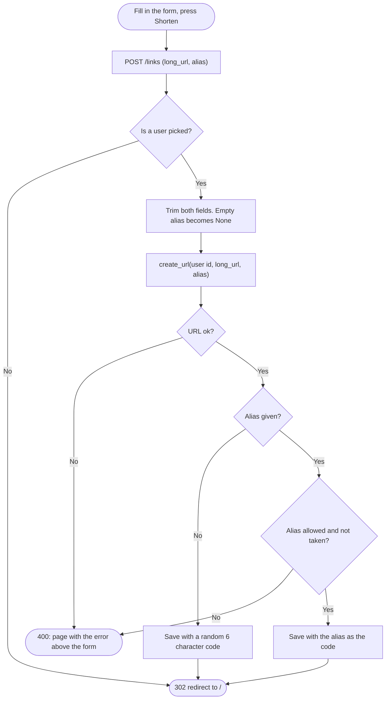

# Spec Sheet: Create Short Link Form

| | |
|---|---|
| **Author** | Daniel S. |
| **Date** | 11/13/2026 |
| **Version** | V1.0 |
| **Jira** | URL-14 (create form on the home page), URL-22 (custom alias box) |
| **Files** | `app/routes.py` (`create_link`), `app/templates/home.html` (uses `create_url()` in `app/urls.py`) |
| **Tests** | `tests/test_create.py` |

## 1. Purpose

The form at the top of the home page that makes a short link for the
current user. There is no separate creation page, so making a link is one
step. It has two boxes:

* **Long URL:** the address to shorten.
* **Custom alias (optional):** my own short code, for example `csc203` to
  get `url.short.com/csc203`. Left empty, a random 6 character code is made.

It is a plain HTML form that POSTs to Flask. No JavaScript and no JSON API.

## 2. Inputs

| Input | Where | Rules |
|---|---|---|
| `long_url` | form field of `POST /links` | must start with `http://` or `https://`, at most 2048 characters, no spaces inside |
| `alias` | form field of `POST /links`, optional | 3 to 32 letters, numbers, `_` or `-`, not a reserved word, not already used. Case sensitive (`CSC203` and `csc203` are different links) |
| Session cookie | the browser | `user_id`, the current user, who becomes the link's owner |

Spaces at the start and end of both boxes are trimmed. The rules themselves
live in `validate_long_url()` and `validate_alias()`, see
[urls.md](urls.md).

## 3. Outputs

| Request | Result |
|---|---|
| Good URL, alias box empty | link saved with a random code, `302` to `/`, the new link is the top row of the table |
| Good URL, good unused alias | link saved with that alias as its code, `302` to `/` |
| Bad URL | `400`, the home page again with the error above the form. Nothing is saved |
| Alias badly formatted or reserved | `400`, same, with the alias error |
| Alias already taken | `400`, "'alias' is already taken." |
| Nobody picked | `302` to `/`, nothing is saved (the page then asks to pick a user) |
| `GET /links` | not a page. It falls through to the short link lookup, and `links` is reserved, so `404` |

After an error both boxes still hold what was typed, so it can be fixed
without typing it again.

## 4. Behavior

* The form only shows when a user is picked, because a link needs an owner.
* `create_link()` reads the two fields and calls
  `create_url(user id, long_url, alias or None)`. An empty alias box arrives
  as `""`, which is turned into `None` so `create_url()` makes a random
  code.
* Every problem `create_url()` can find is a `UrlError`
  (`AliasTakenError` is one too), and its message is written for the user.
  So one `except UrlError` covers all of them and the page shows
  `str(error)` as is.
* MySQL's UNIQUE rule on `urls.code` is what decides an alias is taken, so
  two people asking for the same alias at the same moment can't both get it.
* **Post, then redirect:** after a link is made the answer is a redirect to
  `/`, so pressing refresh can't make the same link twice.
* Jinja escapes the error and the typed values, so they can't inject HTML.

## 5. Function Reference

| Function | File | Route | Returns |
|---|---|---|---|
| `create_link()` | `app/routes.py` | `POST /links` | `302` to `/`, or the page with an error and `400` |
| `create_url(user_id, long_url, alias=None)` | `app/urls.py` | | the new link row. Raises `UrlError` / `AliasTakenError` |

## 6. Flow Chart

## 7. Tests

* `tests/test_create.py` covers the form being on the page only with a user
  picked, a random code link, an alias link, the alias keeping its case,
  trimmed fields, each error (bad URL, bad alias, taken alias) showing above
  the form with the typed values kept, and nobody picked.
* Run: `python -m unittest tests.test_create -v`

## 8. Known Limits

* No copy button or preview of the short link before saving, on purpose
  (kept simple).
* The form has no CSRF token. There is no login to protect, and the class
  asks for no authentication.
* The alias is an extra feature on top of the course spec (URL-22).
