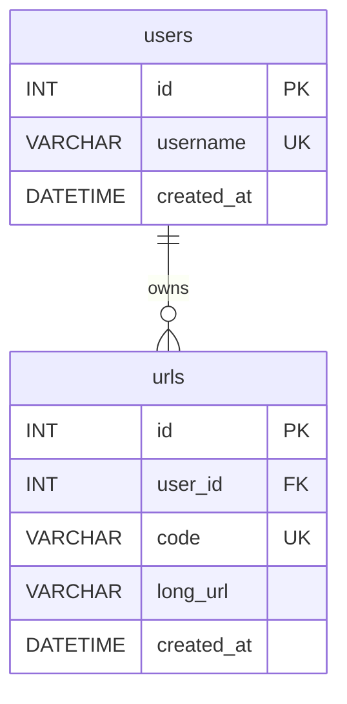
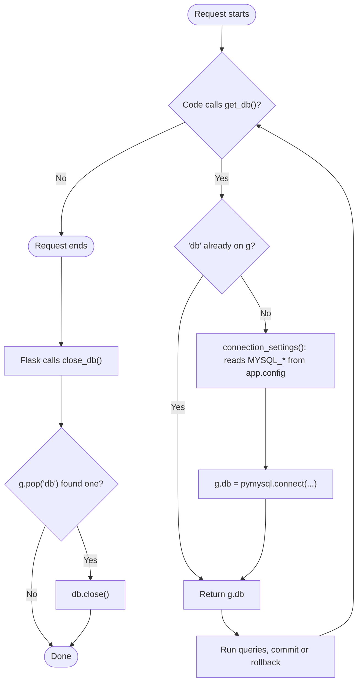
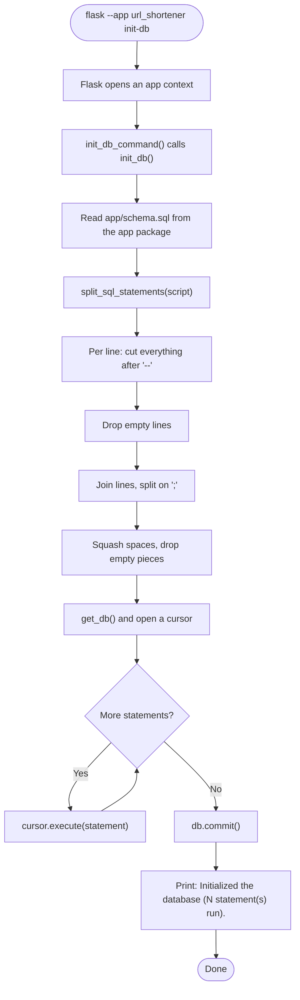

# Spec Sheet: Database Connection and init-db

| | |
|---|---|
| **Author** | Daniel S. |
| **Date** | 11/11/2026 |
| **Version** | V1.1 |
| **Jira** | URL-9 (users table), URL-10 (urls table), URL-26 (settings in one place) |
| **Course spec** | DB-2 (host.docker.internal), DB-5 |
| **Files** | `app/db.py`, `app/schema.sql` |
| **Tests** | `tests/test_db.py` |

## 1. Purpose

Gives every request one MySQL connection, closes it when the request ends,
and adds the `flask --app url_shortener init-db` command that creates the
tables from `app/schema.sql`.

MySQL itself runs on the host laptop, not in a container (URL-29). The
setup steps are in the [host MySQL spec sheet](host-mysql.md).

## 2. Inputs

* `app.config` keys `MYSQL_HOST`, `MYSQL_PORT`, `MYSQL_USER`,
  `MYSQL_PASSWORD`, `MYSQL_DB` (filled by `app/config.py`).
* `app/db.py` has no defaults and no environment variable fallback of its
  own (URL-26). `load_config()` in `app/config.py` always fills all five
  keys, using its own defaults when `.env` leaves one out, so there is one
  place to look. See the app startup spec sheet for the defaults.
* `app/schema.sql`, read from inside the `app` package.

## 3. Outputs

* `get_db()` returns a PyMySQL connection with `charset=utf8mb4`,
  `DictCursor` (rows are dicts) and `autocommit=False`.
* `init_db()` returns how many SQL statements it ran (2 today).
* `flask init-db` prints `Initialized the database (2 statement(s) run).`

## 4. Tables Created (`app/schema.sql`)

**users**

| Column | Type | Rules |
|---|---|---|
| `id` | INT | AUTO_INCREMENT, PRIMARY KEY |
| `username` | VARCHAR(50) | NOT NULL, UNIQUE |
| `created_at` | DATETIME | NOT NULL, defaults to now |

**urls**

| Column | Type | Rules |
|---|---|---|
| `id` | INT | AUTO_INCREMENT, PRIMARY KEY |
| `user_id` | INT | NOT NULL, FOREIGN KEY -> `users.id`, ON DELETE CASCADE |
| `code` | VARCHAR(32) | NOT NULL, UNIQUE, `utf8mb4_bin` (case sensitive) |
| `long_url` | VARCHAR(2048) | NOT NULL |
| `created_at` | DATETIME | NOT NULL, defaults to now |

## 5. Behavior

1. `init_app(app)` (called once at startup) registers `close_db` as a
   teardown and adds the `init-db` command.
2. During a request, the first `get_db()` call opens a connection and saves
   it on `g.db`. Every later call in that request returns the same one.
3. When the request (or app context) ends, Flask calls `close_db()`, which
   pops `g.db` and closes it if it exists.
4. `init_db()` reads `schema.sql`, splits it into statements with
   `split_sql_statements()`, runs each one on one cursor, then commits.

## 6. Function Reference

| Function | Arg(s) | Returns | Raises |
|---|---|---|---|
| `connection_settings()` | | dict of `pymysql.connect()` kwargs, read from `app.config` | `KeyError` if a `MYSQL_*` key is missing, `ValueError` if port isn't a number |
| `get_db()` | | the request's connection | `pymysql.err.OperationalError` if MySQL is unreachable |
| `close_db(error=None)` | exception from Flask (unused) | Nothing | |
| `split_sql_statements(script)` | text of a .sql file | list of statements | |
| `init_db()` | | number of statements run | pymysql errors |
| `init_db_command()` | (CLI) | prints a message | |
| `init_app(app)` | Flask app | Nothing | |

## 7. Flow Chart: One Request's Connection

## 8. Flow Chart: `flask init-db`

## 9. Tests

* `tests/test_db.py` mocks `pymysql.connect`, checks the settings it is
  given, that one connection is reused within a request and closed at
  teardown, the SQL splitter (comments, multiple statements, the real
  schema.sql) and that `flask init-db` runs `init_db()` and prints.
* Run: `python -m unittest tests.test_db -v`

## 10. Known Limits and Notes

* The splitter doesn't understand quotes, so `;` or `--` inside a string
  value in `schema.sql` would break it. `schema.sql` never has one.
* `init-db` only creates missing tables. It never changes an existing
  table, so a column change needs a manual `ALTER TABLE` or a fresh volume.
* **Table changes need a rebuild.** `CREATE TABLE IF NOT EXISTS` skips a
  table that already exists, so it never changes columns. After a schema
  change (like URL-23 dropping `password_hash`), drop the old tables first
  with `DROP TABLE IF EXISTS urls; DROP TABLE IF EXISTS users;` in MySQL,
  then run `flask --app url_shortener init-db` again. This deletes the rows.
