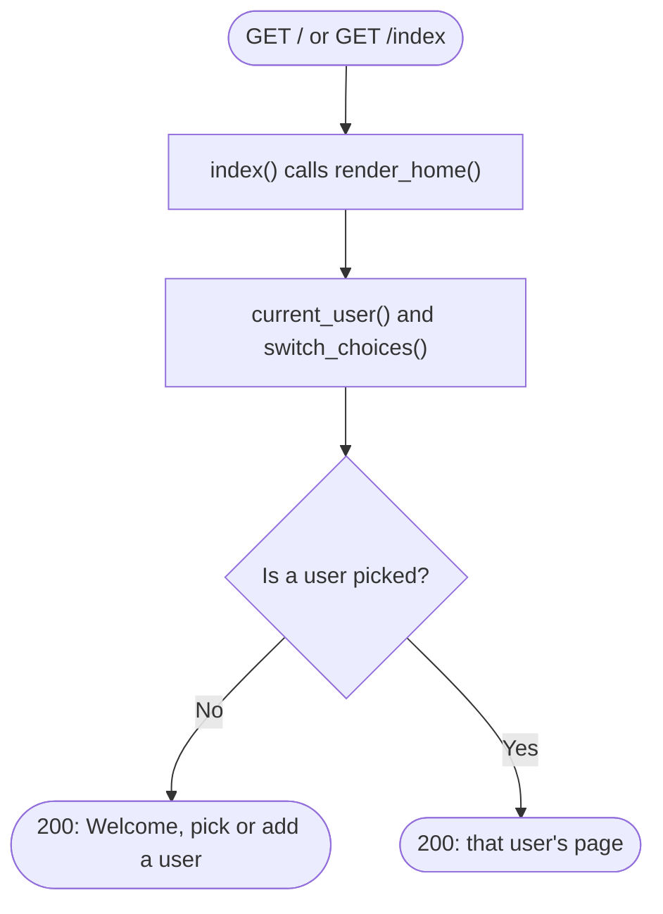

# Spec Sheet: Home Page

| | |
|---|---|
| **Author** | Daniel S. |
| **Date** | 11/13/2026 |
| **Version** | V1.1 |
| **Jira** | URL-13 (pick or add a user message). The list of links is URL-15, the create form is URL-14 |
| **Files** | `app/routes.py`, `app/templates/home.html`, `app/templates/base.html` |
| **Tests** | `tests/test_routes.py`, `tests/test_picker.py` |

## 1. Purpose

The one page of the site, at `/` and `/index`. It is rendered by Flask from
a Jinja template. The header holds the user picker
([user-picker.md](user-picker.md)). With no current user the page asks me to
pick or add one.

## 2. Inputs

| Input | Where | Notes |
|---|---|---|
| `GET /` or `GET /index` | the browser | both run `index()` |
| Session cookie | the browser | `user_id`, the current user |

## 3. Outputs

`200 OK` with the HTML page.

| Situation | Page body |
|---|---|
| Nobody picked (or the picked user no longer exists) | "Welcome" and a line asking to pick or add a user |
| A user is picked | a heading with that user's name. The list of links comes with URL-15 |

## 4. Behavior

* `index()` calls `render_home()`, which renders `home.html` with `user`
  and `choices`.
* `home.html` extends `base.html`, so the header and styling come from
  there and this file only fills in the content block.
* Because `routes.py` is imported before `redirect.py`, `/index` is a page
  and never gets looked up as a short code.

## 5. Function Reference

| Function | Route(s) | Returns |
|---|---|---|
| `index()` | `GET /`, `GET /index` | the home page, status 200 |
| `render_home(status, **extra)` | | `(page HTML, status)` |
| `current_user()` | | the current user's row, or `None` |

## 6. Flow Chart

## 7. Tests

* `tests/test_routes.py` checks `/` and `/index` return 200, and that a made
  up path returns 404 (with the short link lookup mocked).
* `tests/test_picker.py` checks the welcome message and the header.
* Run: `python -m unittest tests.test_routes tests.test_picker -v`

## 8. Planned

* URL-15: a table of the current user's links with a Delete button.
* URL-14 and URL-22: the create form with an optional custom alias box.
