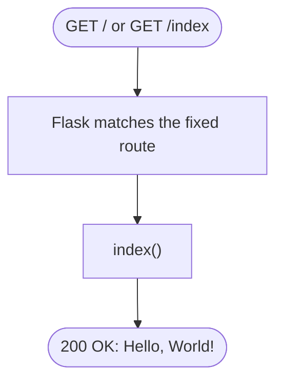

# Spec Sheet: Home Page (Placeholder)

| | |
|---|---|
| **Author** | Daniel S. |
| **Date** | 11/11/2026 |
| **Version** | V1.0 |
| **Jira** | Placeholder for URL-15 (home page) |
| **Files** | `app/routes.py` |
| **Tests** | `tests/test_routes.py` |

## 1. Purpose

Answers `/` and `/index` so the site has a working root page while the real
home page (URL-15) is being built. It also proves the Flask, Gunicorn and
Apache chain is working end to end.

## 2. Inputs

None. `GET /` or `GET /index`.

## 3. Outputs

`200 OK` with the plain text body `Hello, World!`.

## 4. Behavior

Both routes run `index()`, which returns the string. Because `routes.py` is
imported before `redirect.py`, `/index` is a page and never gets looked up
as a short code.

## 5. Function Reference

| Function | Route(s) | Returns |
|---|---|---|
| `index()` | `GET /`, `GET /index` | `"Hello, World!"`, status 200 |

## 6. Flow Chart

## 7. Tests

* `tests/test_routes.py` checks `/` and `/index` return 200 with the text,
  and that a made up path returns 404 (with the short link lookup mocked).
* Run: `python -m unittest tests.test_routes -v`

## 8. Planned (URL-15)

Will render a Jinja template that lists the active user's links from
`list_urls_for_user(current_user_id())`, with copy and delete buttons. See
`main-page-design.md` in the URL_Shortener Docs folder.
