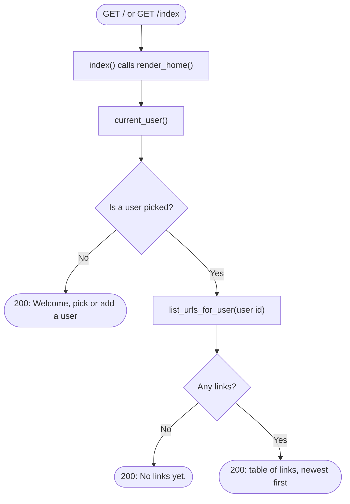
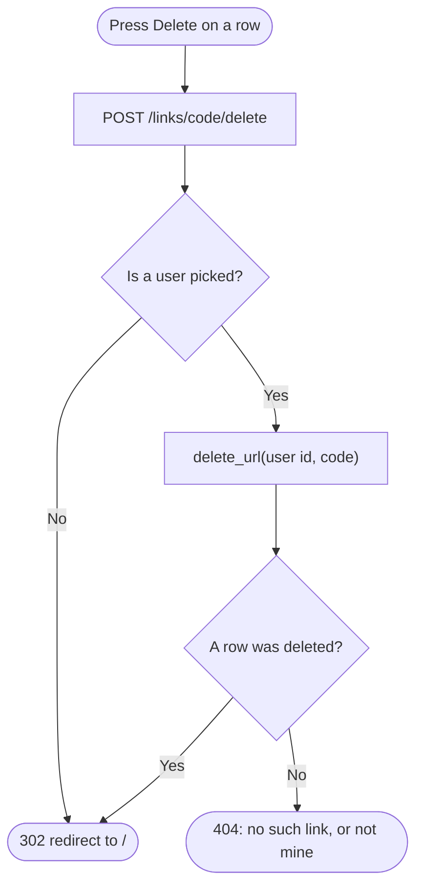

# Spec Sheet: Home Page

| | |
|---|---|
| **Author** | Daniel S. |
| **Date** | 11/13/2026 |
| **Version** | V1.3 |
| **Jira** | URL-15 (list of my links, Delete), URL-13 (pick or add a user message). The create form on this page is URL-14, see [create-form.md](create-form.md) |
| **Files** | `app/routes.py`, `app/templates/home.html`, `app/templates/base.html` |
| **Tests** | `tests/test_home.py`, `tests/test_routes.py`, `tests/test_picker.py` |

## 1. Purpose

The one page of the site, at `/` and `/index`, rendered by Flask from a
Jinja template. The header holds the user picker
([user-picker.md](user-picker.md)). Under it, the page lists the current
user's short links in a plain table, newest first, each with a Delete
button. Above the table is the create short link form
([create-form.md](create-form.md)). With no current user the page asks me to
pick or add one.

Kept simple on purpose: plain HTML forms only, no JSON `/api` routes and no
JavaScript. No stats, search box, copy button or confirm dialog.

## 2. Inputs

| Input | Where | Notes |
|---|---|---|
| `GET /` or `GET /index` | the browser | both run `index()` |
| `code` | `POST /links/<code>/delete`, from a row's Delete button | the short code of the link to remove |
| Session cookie | the browser | `user_id`, the current user |

## 3. Outputs

| Request | Result |
|---|---|
| `GET /` with nobody picked (or the picked user no longer exists) | `200`: "Welcome" and a line asking to pick or add a user |
| `GET /` with a user who has no links | `200`: the user's heading and "No links yet." |
| `GET /` with a user who has links | `200`: a table with one row per link |
| `POST /links/<code>/delete` for my own link | link removed, `302` to `/` |
| `POST /links/<code>/delete` for a link that doesn't exist or is someone else's | `404`, nothing removed |
| `POST /links/<code>/delete` with nobody picked | `302` to `/`, nothing removed |
| `GET /links/<code>/delete` | `405 Method Not Allowed` |

Table columns:

| Column | Shows |
|---|---|
| Short link | the site's address + the code, as a link (for example `http://url.short.com/abc123`) |
| Original URL | the long URL |
| Created | the date as MM/DD/YYYY |
| (last) | the Delete button |

## 4. Behavior

* `index()` calls `render_home()`, which renders `home.html` with `user`,
  `choices`, `links` and `base_url`.
* **Only my links:** `links` comes from `list_urls_for_user(user id)`, which
  filters by owner in its SQL and sorts newest first. With nobody picked the
  list is empty and the database isn't asked.
* **Short link address:** `base_url` is `request.host_url`, the address the
  browser used. So the links read `http://127.0.0.1:5000/...` when the page
  is opened that way and `http://url.short.com/...` through Apache.
* **Delete only removes my own link:** `delete_link()` passes the current
  user's id to `delete_url()`, whose DELETE statement has the owner check in
  it. Guessing another user's code gets a 404 and removes nothing.
* **Delete is a POST from a small form in each row**, not a link, so opening
  an address can never delete anything. After it works the answer is a
  redirect to `/`, so a refresh can't resend it.
* `home.html` extends `base.html`, so the header and styling come from
  there. Jinja escapes everything it prints, so a long URL can't inject HTML.
* Because `routes.py` is imported before `redirect.py`, `/index` is a page
  and never gets looked up as a short code. `/links/<code>/delete` has two
  slashes, so it can't be mistaken for a short code either, and `links` is a
  reserved word.

## 5. Function Reference

| Function | Route(s) | Returns |
|---|---|---|
| `index()` | `GET /`, `GET /index` | the home page, status 200 |
| `delete_link(code)` | `POST /links/<code>/delete` | `302` to `/`, or `404` |
| `render_home(status, **extra)` | | `(page HTML, status)` |
| `current_user()` | | the current user's row, or `None` |

## 6. Flow Charts

Showing the page:

Deleting a link:

## 7. Tests

* `tests/test_home.py` covers the table (rows, short link address, date,
  escaping, "No links yet."), that only the current user's id is asked for,
  and Delete (works, not mine, nobody picked, GET refused).
* `tests/test_routes.py` checks `/` and `/index` return 200 and that a made
  up path returns 404. `tests/test_picker.py` covers the header.
* Run: `python -m unittest tests.test_home tests.test_routes -v`

## 8. Known Limits

* No confirm step before a delete, on purpose (kept simple).
* Delete has no CSRF token. There is no login to protect, and the class
  asks for no authentication.
