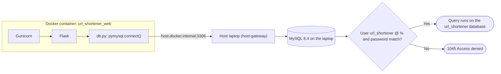
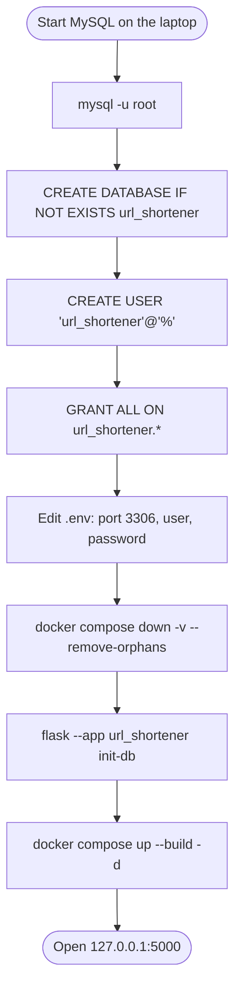

# Spec Sheet: Host MySQL (Database Outside the Container)

| | |
|---|---|
| **Author** | Daniel S. |
| **Date** | 11/11/2026 |
| **Version** | V1.0 |
| **Jira** | URL-29 (move the database to the host MySQL) |
| **Course spec** | DB-1 (MySQL stays on the host), DB-2, DB-3, DB-4, DB-5 |
| **Files** | `compose.yaml`, `.env.example`, `app/config.py` (defaults) |
| **Tests** | `tests/test_config.py`, `tests/test_compose.py` |

## 1. Purpose

The course spec says MySQL shall stay on the host, outside the application
container (DB-1). So the app container only runs Gunicorn and Flask, and it
connects out to the MySQL 8.4 install on the laptop. This sheet covers how
that connection is set up and the one time steps to create the app's MySQL
user. Before URL-29, MySQL ran in its own container from `compose.yaml`.

## 2. Inputs

| Input | Value | Where |
|---|---|---|
| `MYSQL_HOST` | `host.docker.internal` (DB-2) | `.env` |
| `MYSQL_PORT` | `3306`, the laptop MySQL's port | `.env` |
| `MYSQL_USER` / `MYSQL_PASSWORD` | the dedicated app user (DB-3) | `.env`, must match the user made in MySQL |
| `MYSQL_DB` | `url_shortener` | `.env` |
| A running MySQL 8.4 on the laptop | port 3306 | started by hand or as a Windows service |

## 3. Outputs

* One container, `url_shortener_web`. No `db` service, no `db_data` volume
  and no `MYSQL_ROOT_PASSWORD` in `.env` any more.
* The tables live in the laptop's MySQL, so `docker compose down` (even with
  `-v`) never deletes the data.
* `SELECT user, host FROM mysql.user;` on the laptop shows
  `url_shortener | %`.

## 4. Behavior

* **How the container finds the laptop.** `compose.yaml` has
  `extra_hosts: host.docker.internal:host-gateway`, so inside the container
  that name points at the host machine (DOC-5). PyMySQL connects to
  `host.docker.internal:3306`.
* **Why the user's host is `%`.** A connection from the container does not
  come from `localhost`, it comes from a Docker address (about 172.17.x.x).
  A user made as `'url_shortener'@'localhost'` would be refused, so the app
  user is made as `'url_shortener'@'%'`, meaning any host (DB-4).
* **Why a dedicated user.** The app never uses `root`. Its user can only
  touch the `url_shortener` database (DB-3).
* **`flask run` on the laptop** uses the same `.env`. If
  `host.docker.internal` times out from Windows itself, set
  `$env:MYSQL_HOST="127.0.0.1"` in that terminal only.
* **Rebuild after `.env` changes.** The image carries `.env`, so run
  `docker compose up --build -d` after editing it (DB-5).

### One time setup on the laptop

1. Make sure MySQL 8.4 is running, then open its shell as root:
   `& "C:\Program Files\MySQL\MySQL Server 8.4\bin\mysql.exe" -u root`
2. Run this SQL (pick a real password in place of `change_me`):

```sql
CREATE DATABASE IF NOT EXISTS url_shortener CHARACTER SET utf8mb4;
CREATE USER IF NOT EXISTS 'url_shortener'@'%' IDENTIFIED BY 'change_me';
GRANT ALL PRIVILEGES ON url_shortener.* TO 'url_shortener'@'%';
FLUSH PRIVILEGES;
SELECT user, host FROM mysql.user;
```

3. In `.env` set `MYSQL_PORT=3306`, and `MYSQL_USER` / `MYSQL_PASSWORD` to
   match step 2. Delete the old `MYSQL_ROOT_PASSWORD` line.
4. Remove the old MySQL container and its volume:
   `docker compose down -v --remove-orphans`
5. Create the tables in the laptop's MySQL:
   `flask --app url_shortener init-db`
6. Rebuild and start the app: `docker compose up --build -d`

## 5. Flow Chart: A Query From the Container



## 6. Flow Chart: One Time Setup



## 7. Tests

* `tests/test_config.py` checks the defaults are `host.docker.internal` and
  port `3306`.
* `tests/test_compose.py` reads `compose.yaml` and `.env.example` as text and
  checks there is no `db` service, volume or root password left, that the
  `host.docker.internal` line is still there, and that the example port is
  3306.
* The real connection can only be checked on the laptop: run the setup
  above, then open a short link through `127.0.0.1:5000`.
* Run: `python -m unittest tests.test_config tests.test_compose -v`

## 8. Known Limits and Notes

* Compose can't start or wait for MySQL any more. If MySQL isn't running,
  the app starts but database pages fail with `2003 Can't connect`.
* If the container gets `2003 Can't connect` while MySQL is running, check
  `bind-address` in `C:\ProgramData\MySQL\my.ini`. It must not be
  `127.0.0.1` only, and Windows Firewall must allow port 3306 from Docker.
* `1045 Access denied` means the user or password in `.env` doesn't match
  the MySQL user, or the user was made as `@'localhost'` instead of `@'%'`.
* `'%'` lets that user connect from any machine that can reach port 3306.
  That is fine for a laptop demo, the user is limited to one database.
