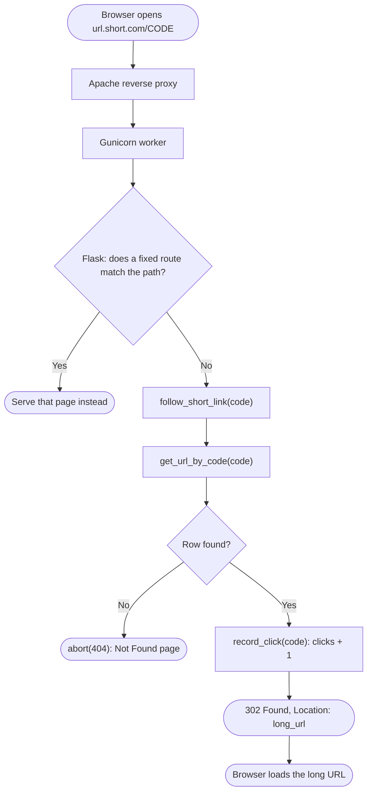
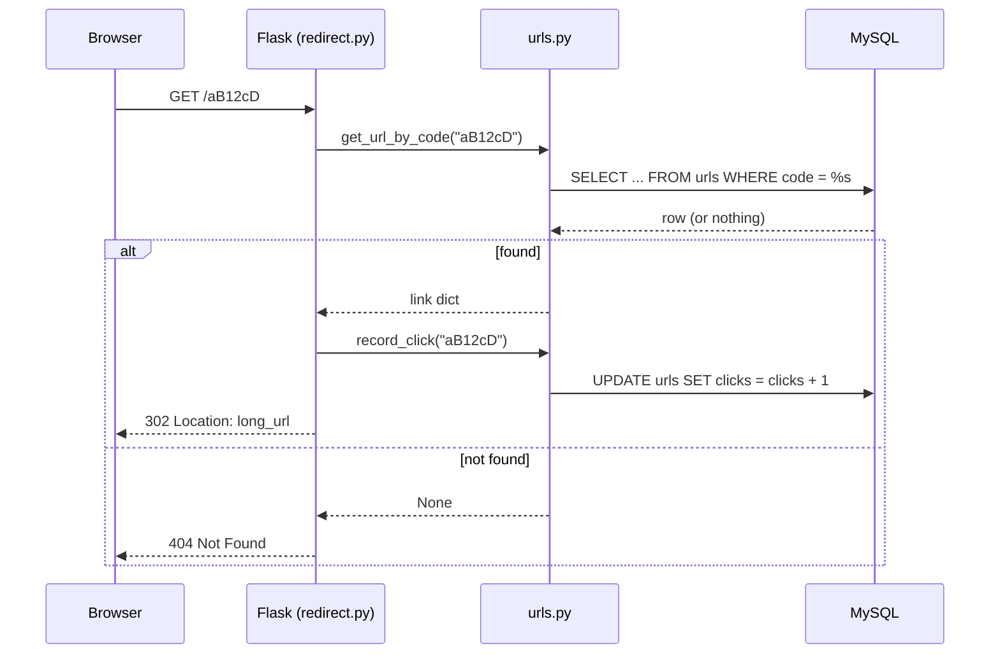

# Spec Sheet: Short Link Redirect

| | |
|---|---|
| **Author** | Daniel S. |
| **Date** | 11/11/2026 |
| **Version** | V1.0 |
| **Jira** | URL-11 (redirect) |
| **Files** | `app/redirect.py` (uses `app/urls.py`) |
| **Tests** | `tests/test_redirect.py`, `tests/test_routes.py` (404 case) |

## 1. Purpose

When someone visits `url.short.com/<code>`, send their browser to the saved
long URL and add one to that link's click count.

## 2. Inputs

| Input | Where | Notes |
|---|---|---|
| `code` | the single path segment after the domain | Case sensitive. `/a/b` (two segments) never reaches this route |

## 3. Outputs

| Case | HTTP response |
|---|---|
| Code exists | `302 Found`, `Location: <long_url>`, click count +1 |
| Code unknown | `404 Not Found`, nothing counted |
| Path is a fixed page (`/`, `/index`, `/switch/<id>`) | that page, the lookup never runs |

## 4. Behavior

1. Apache (reverse proxy) passes the request to Gunicorn, which hands it to
   Flask.
2. Flask tries fixed routes first. Only a path no fixed route matches goes
   to `follow_short_link(code)`. Fixed routes win because they are more
   specific than a `<code>` variable, and `redirect.py` is also imported
   last in `app/__init__.py`.
3. `get_url_by_code(code)` looks up the row.
4. Not found: `abort(404)`.
5. Found: `record_click(code)` then `redirect(long_url, code=302)`.

**Why 302 and not 301:** a 301 is permanent, so browsers cache it and skip
the server next time, and those visits would never be counted. 302 makes
every visit come back through the app.

## 5. Function Reference

| Function | Route | Arg(s) | Returns |
|---|---|---|---|
| `follow_short_link(code)` | `GET /<code>` | short code | 302 to the long URL, or 404 |

| Constant | Value | Meaning |
|---|---|---|
| `REDIRECT_STATUS` | `302` | Temporary redirect so clicks keep counting |

## 6. Flow Chart

## 7. Sequence

## 8. Tests

* `tests/test_redirect.py` uses Flask's test client with `get_url_by_code`
  and `record_click` mocked in `app.redirect`. It checks the 302 and its
  Location, that one click is recorded, that an unknown code is a 404 with
  no click, that `/index` never reaches the lookup, and that the code is
  passed through with its case unchanged.
* `tests/test_routes.py::test_unknown_page_is_404` checks a made up path.
* Run: `python -m unittest tests.test_redirect -v`

## 9. Known Limits and Notes

* The click is counted before the redirect, so a visitor who closes the
  tab right away still counts.
* There is no custom 404 page yet, Flask's default is shown.
