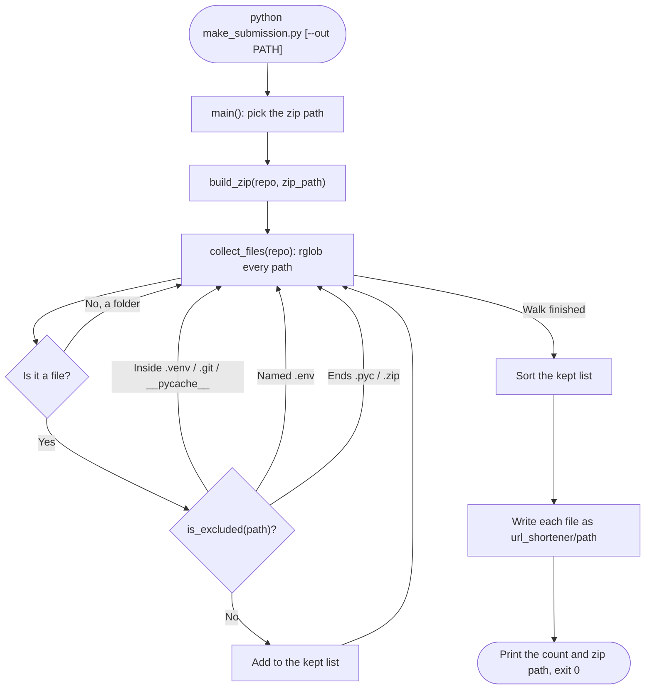

# Spec Sheet: Submission Zip

| | |
|---|---|
| **Author** | Daniel S. |
| **Date** | 11/25/2026 |
| **Version** | V1.0 |
| **Jira** | URL-21 (submit the project and do the live demo) |
| **Course spec** | SUB-1 (code on GitHub), SUB-2 (zip without the venv) |
| **Files** | `make_submission.py` |
| **Tests** | `tests/test_make_submission.py`, `tests/test_docs.py` |

## 1. Purpose

The course wants the project folder zipped, without the virtual environment,
and uploaded to eLearning (SUB-2). Zipping by hand in Explorer makes it easy
to drag in `.venv` (hundreds of MB) or `.env` (the real MySQL password).
`make_submission.py` builds the zip the same way every time and leaves those
out automatically.

## 2. Inputs

| Input | Where | Notes |
|---|---|---|
| The repo folder | the folder `make_submission.py` sits in | Walked at every depth |
| `--out PATH` | command line, optional | Where to write the zip. Default: `../url_shortener_submission.zip`, next to the repo folder |

## 3. Outputs

| Output | Notes |
|---|---|
| A `.zip` file at `--out` | Every kept file sits under one top level folder, `url_shortener/` |
| Two lines printed | How many files went in, where the zip is, and what was left out |
| Exit code `0` | When the zip was written |

### What is left out

| Rule | Matches | Why |
|---|---|---|
| Folder name | `.venv`, `.venv-wsl`, `venv`, `env` | SUB-2 says no virtual environment (`.venv-wsl` is the one the Gunicorn demo makes in WSL) |
| Folder name | `.git` | Git history, the grader uses the GitHub link (SUB-1) |
| Folder name | `__pycache__`, `.pytest_cache`, `.mypy_cache` | Generated caches |
| File name | `.env` | Real passwords. `.env.example` IS kept as the template |
| File ending | `.pyc`, `.pyo` | Compiled Python |
| File ending | `.zip` | Older submission zips, so a zip never lands inside the next one |

Everything else goes in: the app, templates, tests, docs and spec sheets,
`Dockerfile`, `compose*.yaml`, `gunicorn_config.py`, `requirements.txt`,
`.env.example`, `.gitignore`, `.dockerignore` and `.vscode/settings.json`.

## 4. Behavior

1. `main()` reads `--out` (or uses the default next to the repo folder, so
   the zip is never inside the folder being zipped).
2. `build_zip()` calls `collect_files()`, which walks the repo with
   `rglob("*")`, skips folders (they are made from the file paths) and asks
   `is_excluded()` about every file.
3. `is_excluded()` splits the relative path into folders and a file name.
   Any excluded folder on the path, an excluded file name, or an excluded
   ending means the file is skipped.
4. The kept list is sorted, so the zip's contents are in the same order on
   every run.
5. Each file is written as `url_shortener/<path>` with forward slashes and
   normal deflate compression, which Windows Explorer opens.
6. `main()` prints the count and the zip's full path.

## 5. Function Reference

| Function | Arg(s) | Returns |
|---|---|---|
| `is_excluded(relative_path)` | path relative to the repo | `True` to leave the file out |
| `collect_files(repo)` | the repo folder | sorted list of relative paths to keep |
| `build_zip(repo, zip_path)` | repo folder, zip to write | the list of files written |
| `main(argv=None)` | command line arguments | `0` |

| Constant | Value | Meaning |
|---|---|---|
| `ZIP_ROOT` | `url_shortener` | Folder name inside the zip |
| `DEFAULT_ZIP_NAME` | `url_shortener_submission.zip` | Default output file name |
| `EXCLUDED_DIRS` / `EXCLUDED_FILES` / `EXCLUDED_SUFFIXES` | see the table above | The leave-out rules |

## 6. Flow Chart



## 7. How to Use It for the Submission

In VS Code, open a terminal in the repo folder
(`C:\College\CSC\203\url_shortener`) and run:

```powershell
python make_submission.py
```

The zip appears at `C:\College\CSC\203\url_shortener_submission.zip`. Open it
in Explorer and check there is no `.venv` or `.env` inside, then upload it to
eLearning.

## 8. Tests

* `tests/test_make_submission.py` checks `is_excluded()` keeps project files
  and `.env.example` but drops `.env`, venvs, `.git`, caches, `.pyc` and old
  zips. It builds a fake project in a temporary folder, zips it, and checks
  the zip holds exactly the kept files under `url_shortener/`, that file
  contents survive, and that `main()` honors `--out`.
* `tests/test_docs.py` checks `make_submission.py` has its header, spec
  sheet link and docstrings.
* Run: `python -m unittest tests.test_make_submission -v`

## 9. Known Limits and Notes

* Untracked files you have lying around in the repo folder (scratch notes,
  screenshots) go in too, since the script zips the folder, not Git's list.
  Look over the printed count, or the zip, before uploading.
* `.vscode/settings.json` is kept on purpose so the grader's VS Code finds
  the unit tests.
