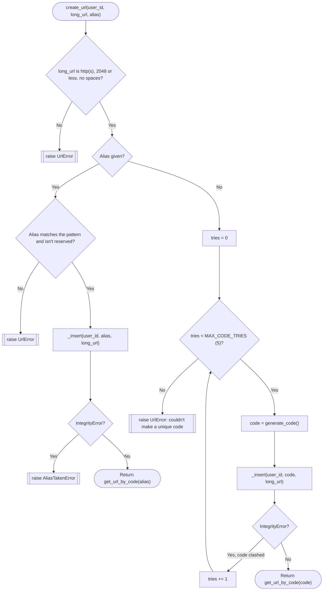
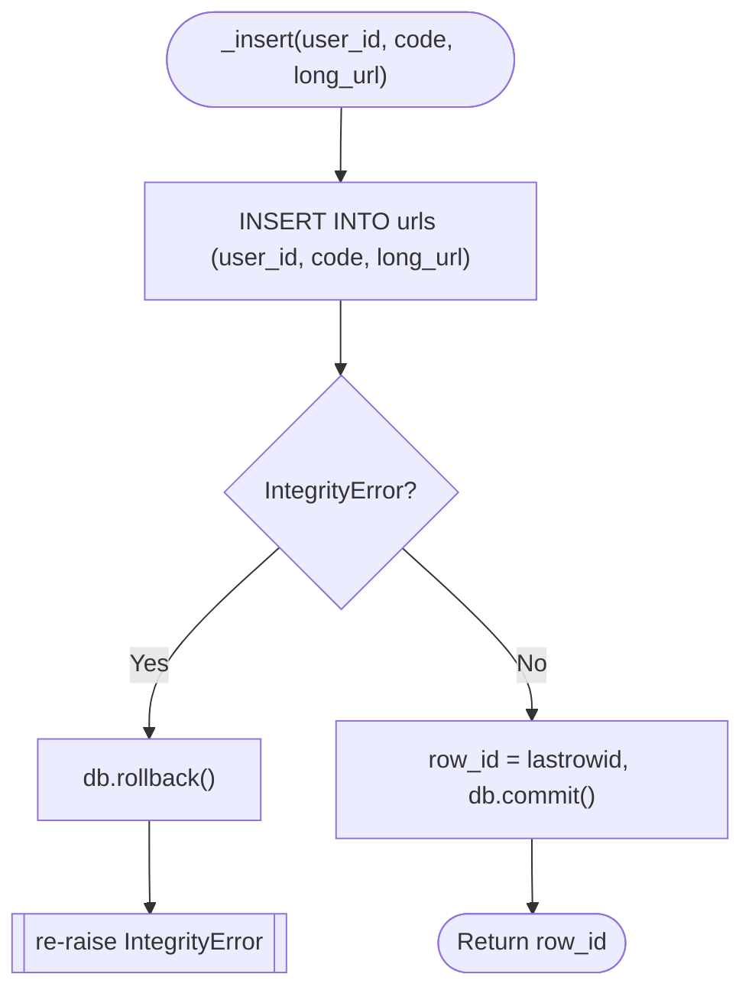
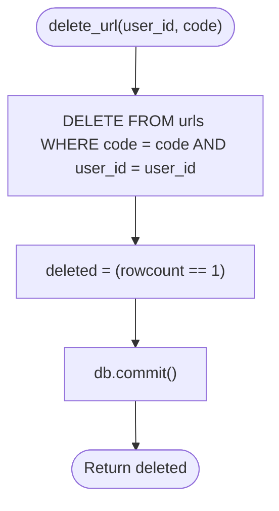

# Spec Sheet: URLs (Short Codes and Links)

| | |
|---|---|
| **Author** | Daniel S. |
| **Date** | 11/11/2026 |
| **Version** | V1.2 |
| **Jira** | URL-10 (URL database). Used by URL-11 (redirect), URL-14 (create form), URL-15 (home page), URL-22 (custom alias box) |
| **Files** | `app/urls.py`, `urls` table in `app/schema.sql` |
| **Tests** | `tests/test_urls.py` |

## 1. Purpose

Saves short links, makes random short codes or accepts a custom alias,
looks a code up for the redirect, and lists or deletes a
user's links. There are no routes in this file, the pages call these
functions.

## 2. Inputs

| Input | Rule |
|---|---|
| `long_url` | String starting with `http://` or `https://`, at most 2048 characters, no whitespace anywhere |
| `alias` (optional) | 3 to 32 characters of `A-Z a-z 0-9 _ -` (`ALIAS_PATTERN`), and not in `RESERVED_CODES` in any case |
| `user_id` | the owner's `users.id` |
| `code` | the part after the domain, matched case sensitively |

`RESERVED_CODES` = `login, logout, home, api, static, admin, favicon.ico, index,
users, switch, links`. The last three are the addresses the page's forms post to.

## 3. Outputs

A link dict has `id, user_id, code, long_url, created_at`.

| Function | Output |
|---|---|
| `create_url` | the new link dict |
| `get_url_by_code` | link dict or `None` |
| `list_urls_for_user` | list of link dicts, newest first (ties broken by id) |
| `delete_url` | `True` if deleted, `False` if missing or not theirs |
| `generate_code` | 6 random characters from `a-z A-Z 0-9` |

## 4. Behavior

* **Random codes** use `secrets.choice`, 6 characters from 62, about 56
  billion combinations. If the INSERT hits the `UNIQUE` rule, a new code is
  made and tried, up to `MAX_CODE_TRIES` (5), then `UrlError`.
* **Aliases** are tried once. A clash raises `AliasTakenError`, which is a
  subclass of `UrlError`.
* **Clashes are caught by MySQL**, not by looking first, so two requests at
  the same moment can't both get the same code.
* **Every failed INSERT is rolled back** in `_insert` before the error is
  passed up, so the connection is clean for the next try.
* **Owner check in SQL.** `delete_url` runs
  `DELETE ... WHERE code = %s AND user_id = %s`, so a user can only delete
  their own links.
* **No SQL injection.** All values go through `%s` placeholders. The only
  f-string is the fixed `URL_COLUMNS` list.

## 5. Function Reference

| Function | Arg(s) | Returns | Raises |
|---|---|---|---|
| `validate_long_url(long_url)` | URL | Nothing | `UrlError` |
| `validate_alias(alias)` | alias | Nothing | `UrlError` |
| `generate_code()` | | 6 character code | |
| `_insert(user_id, code, long_url)` | owner, code, URL | new row id | `pymysql.err.IntegrityError` |
| `create_url(user_id, long_url, alias=None)` | owner, URL, optional alias | link dict | `UrlError`, `AliasTakenError` |
| `get_url_by_code(code)` | code | link dict or `None` | |
| `list_urls_for_user(user_id)` | owner | list of link dicts | |
| `delete_url(user_id, code)` | asker, code | `True` / `False` | |

## 6. Flow Chart: `create_url`

## 7. Flow Chart: `_insert`

## 8. Flow Chart: `delete_url`

## 9. Tests

* `tests/test_urls.py` mocks `get_db()`. It checks the URL rules
  (including blocking `javascript:`), the alias rules and reserved words in
  any case, code length and randomness, saving a random code, retrying on a
  clash, giving up after 5 tries, aliases, a taken alias, the lookup, newest
  first listing, and deleting your own vs someone else's link.
* Run: `python -m unittest tests.test_urls -v`

## 10. Known Limits and Notes

* `generate_code()` does not check `RESERVED_CODES`. `logout` and `static`
  are 6 letters, so in theory a random code could equal one (about 2 in 56
  billion per link). It would save fine but the fixed page would win at
  that path once `/logout` exists. Could be fixed later by skipping reserved
  codes in the retry loop.
* Click counts were removed in URL-25, links have no usage numbers.
* Validation checks the shape of the URL only. It doesn't check that the
  site exists.
