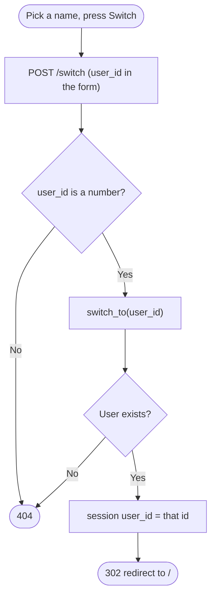
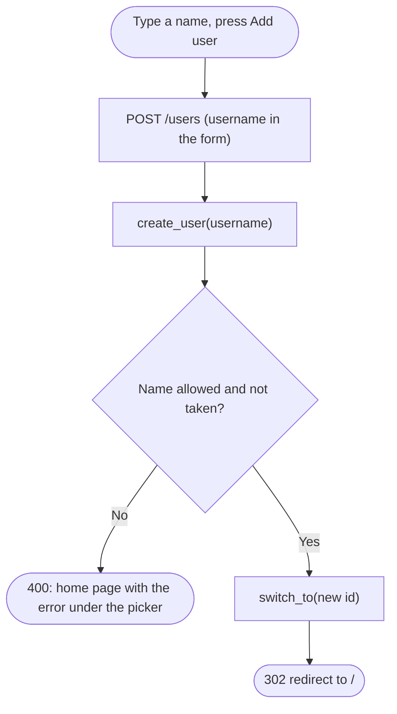

# Spec Sheet: User Picker

| | |
|---|---|
| **Author** | Daniel S. |
| **Date** | 11/13/2026 |
| **Version** | V1.0 |
| **Jira** | URL-13 (user picker). Built on URL-12 / URL-24 (user swapping) and URL-23 (no passwords) |
| **Files** | `app/templates/base.html`, `app/routes.py` (`add_user`), `app/accounts.py` (`switch_user_form`) |
| **Tests** | `tests/test_picker.py` |

## 1. Purpose

The control in the header of every page that says who is using the site. It
replaces a login page. The class only asks for the ability to swap between
users, with no authentication, so there is no password anywhere:

* **Switch user:** a dropdown of every username and a Switch button.
* **Add user:** a text box and an Add user button. The new user becomes the
  current user right away.

It is two plain HTML forms rendered by a Jinja template. No JavaScript.

## 2. Inputs

| Input | Where | Notes |
|---|---|---|
| `user_id` | form field of `POST /switch` (the dropdown) | must be a number of a user that exists, else 404 |
| `username` | form field of `POST /users` (the Add user box) | 3 to 50 letters, numbers, `_` or `-`, and not taken. Spaces around it are trimmed |
| Session cookie | the browser | holds `user_id`, the current user (see [user-swap.md](user-swap.md)) |

## 3. Outputs

| Request | Result |
|---|---|
| `POST /switch` with a real `user_id` | session now holds that id, `302` to `/` |
| `POST /switch` with a missing, non number or unknown `user_id` | `404`, session unchanged |
| `POST /users` with a good new name | user row created, session switched to it, `302` to `/` |
| `POST /users` with a bad or taken name | `400`, the home page again with the error under the picker and the typed name still in the box. Nothing is created |
| `GET /switch` or `GET /users` | not pages. They fall through to the short link lookup, and both words are reserved so no link can use them, which makes them `404` |

What the header shows:

| Situation | Header |
|---|---|
| No users in the table | only the Add user box |
| Users exist, nobody picked | dropdown + Add user box |
| A user is picked | the same, with that user selected in the dropdown and "Current user: name" under it |

## 4. Behavior

* `render_home()` in `app/routes.py` gives the template `user`
  (`current_user()`) and `choices` (`switch_choices()`), so the header is
  the same on every page that uses `base.html`.
* **Why the dropdown posts to `/switch` and not `/switch/<id>`:** a dropdown
  can't change the address its form posts to without JavaScript. So the id
  travels as a form field, and `switch_user_form()` reads it and calls the
  same `switch_to()` that `/switch/<id>` uses.
* **Add user** calls `create_user(username)`. That function validates the
  name and lets MySQL's UNIQUE rule catch a duplicate. Either problem comes
  back as a `UserError` whose message is shown as is.
* **Post, then redirect:** after a form works the answer is a redirect to
  `/`, so pressing refresh can't send the form a second time.
* **Stale session:** if the remembered user was deleted from the table,
  `current_user()` returns `None` and the page asks to pick a user again.
* Jinja escapes everything it prints, so a username can't inject HTML.

## 5. Function Reference

| Function | File | Route | Returns |
|---|---|---|---|
| `current_user()` | `app/routes.py` | | the current user's row, or `None` |
| `render_home(status, **extra)` | `app/routes.py` | | `(page HTML, status)` |
| `add_user()` | `app/routes.py` | `POST /users` | `302` to `/`, or the page with an error and `400` |
| `switch_user_form()` | `app/accounts.py` | `POST /switch` | `302` to `/`, or `404` |

## 6. Flow Charts

Switching with the dropdown:

Adding a user:

## 7. Tests

* `tests/test_picker.py` covers the header (dropdown options, selected
  user, no dropdown with no users), the welcome message with nobody picked,
  the stale session case, Add user (works, bad name, taken name, trimmed
  spaces) and the dropdown route (works, unknown id, missing id, not a
  number).
* Run: `python -m unittest tests.test_picker -v`

## 8. Known Limits

* No passwords and no login, on purpose (the class asks for swapping only).
  Anyone using the browser can switch to any user.
* Users can be added but not renamed or deleted from the page.
