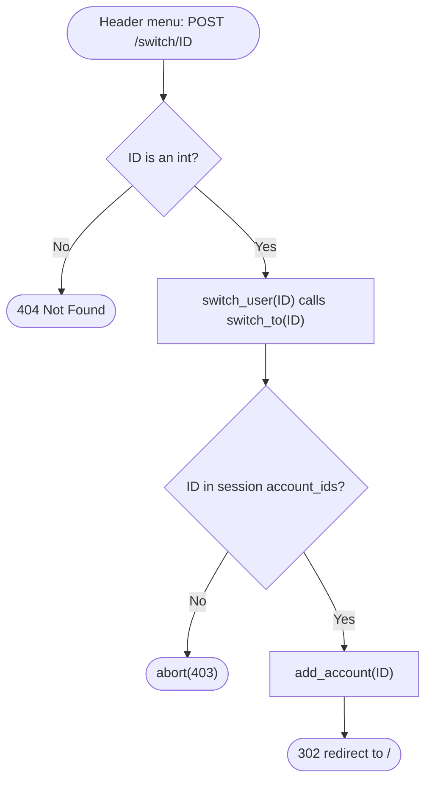
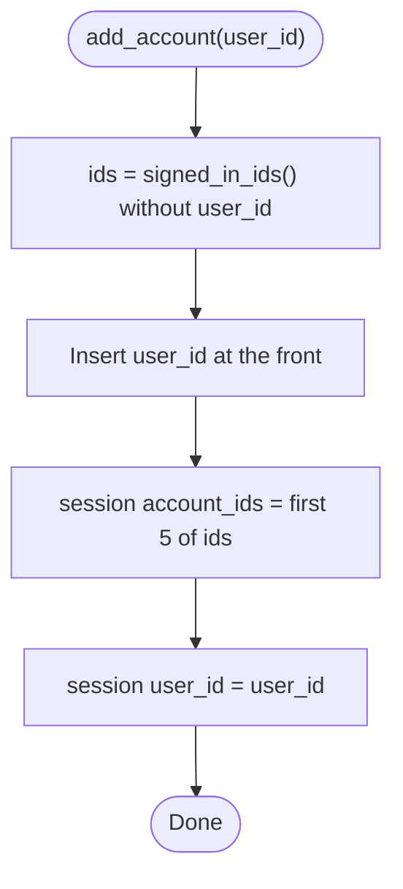
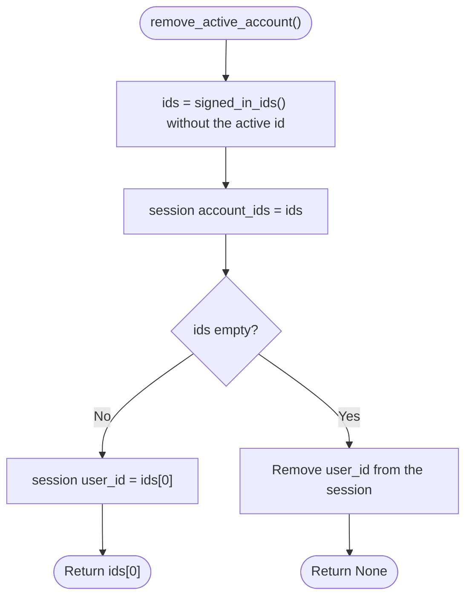
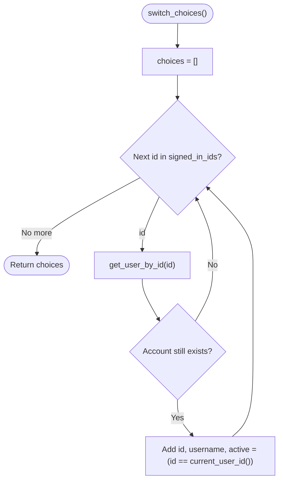

# Spec Sheet: User Swapping

| | |
|---|---|
| **Author** | Daniel S. |
| **Date** | 11/11/2026 |
| **Version** | V1.0 |
| **Jira** | URL-12 (user swapping). Login itself is URL-13 |
| **Files** | `app/accounts.py` (uses `app/users.py`) |
| **Tests** | `tests/test_accounts.py` |

## 1. Purpose

Lets someone who has logged into more than one account on the same browser
jump between them from a "Switch user" menu without typing the password
again (decided by Dan 11/11/2026). Each account must have logged in on this
browser once, with its password, before it can be switched to.

## 2. Inputs

| Input | Where | Notes |
|---|---|---|
| `user_id` | login route (URL-13) after `verify_user()` passes | goes to `add_account()` |
| `user_id` | `POST /switch/<int:user_id>` from the header menu | must be an int, else 404 |
| Session cookie | the browser | signed with `SECRET_KEY` so it can't be edited |

## 3. Outputs and State

The session (Flask's signed cookie) holds:

| Key | Example | Meaning |
|---|---|---|
| `account_ids` (`ACCOUNTS_KEY`) | `[7, 3, 12]` | every account signed in here, most recently used first, at most 5 (`MAX_ACCOUNTS`) |
| `user_id` (`ACTIVE_KEY`) | `7` | the active account |

| Function / Route | Output |
|---|---|
| `POST /switch/<id>` | `302` to `/` if that id is signed in here, else `403 Forbidden` |
| `GET /switch/<id>` | `405 Method Not Allowed` |
| `switch_choices()` | list of `{id, username, active}` for the menu |

## 4. Behavior

* **add_account(id)** removes the id if it's already in the list, puts it
  first, trims the list to 5 (oldest falls off) and makes it active.
* **switch_to(id)** only works for ids already in the list, and reuses
  `add_account` so the account moves to the front.
* **remove_active_account()** takes the active id out. If anyone is left,
  the first one becomes active. Otherwise `user_id` is removed (logged out).
* **switch_choices()** looks up each id's username and skips ids whose
  account has been deleted since.
* **Safety:**
  * The cookie is signed, so a user can't add someone else's id.
  * `/switch` is POST only, so a link someone sends can't swap your account.
  * It always redirects to `/`, never to the Referer, so it can't be used to
    bounce people to another site.

## 5. Function Reference

| Function | Arg(s) | Returns |
|---|---|---|
| `signed_in_ids()` | | copy of the id list (empty if none) |
| `add_account(user_id)` | id that just logged in | Nothing |
| `switch_to(user_id)` | id to swap to | `True` if swapped, `False` if not signed in here |
| `remove_active_account()` | | new active id, or `None` |
| `current_user_id()` | | active id, or `None` |
| `switch_choices()` | | list of menu dicts |
| `switch_user(user_id)` | route `POST /switch/<int:user_id>` | redirect to `/`, or 403 |

## 6. Flow Chart: `POST /switch/<id>`

## 7. Flow Chart: `add_account`

## 8. Flow Chart: `remove_active_account` (log out one account)

## 9. Flow Chart: `switch_choices` (menu list)

## 10. Tests

* `tests/test_accounts.py` runs inside `app.test_request_context()` with
  `get_user_by_id` mocked. It checks first login, newest first ordering, no
  duplicates, the 5 account cap, switching to a signed in vs unknown
  account, logout handing over to the next account and logging fully out,
  the menu (active flag, deleted accounts skipped), and the route's 302,
  403 and 405.
* Run: `python -m unittest tests.test_accounts -v`

## 11. Known Limits and Notes

* Nothing calls `add_account()` yet because the login page (URL-13) isn't
  built. Until then the list is always empty and every switch is a 403.
* The header menu and logout route are not built yet either.
