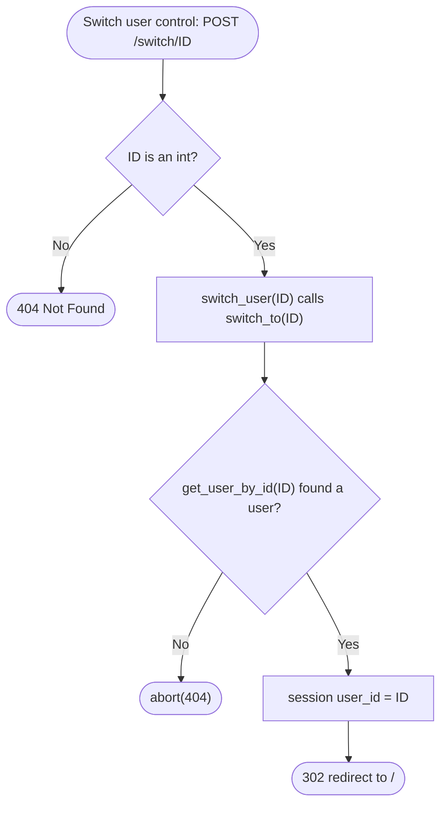
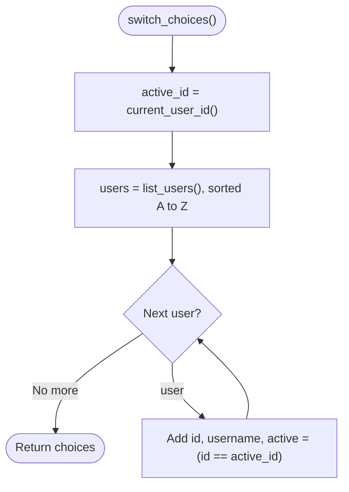

# Spec Sheet: User Swapping

| | |
|---|---|
| **Author** | Daniel S. |
| **Date** | 11/13/2026 |
| **Version** | V1.2 |
| **Jira** | URL-12 (user swapping), URL-24 (simplified, no sign in list). The picker page is URL-13 |
| **Files** | `app/accounts.py` (uses `app/users.py`) |
| **Tests** | `tests/test_accounts.py` |

## 1. Purpose

Lets whoever is using the site swap between users. The session remembers
one thing, the current user's id, and one POST changes it to any user that
exists. There are no passwords and no login, because the class only asks for
the ability to swap between users, not authentication (URL-23, URL-24).

## 2. Inputs

| Input | Where | Notes |
|---|---|---|
| `user_id` | `POST /switch/<int:user_id>`, in the address | must be an int, else 404 |
| `user_id` | `POST /switch`, as a form field from the picker's dropdown (URL-13) | must be a number, else 404 |
| Session cookie | the browser | signed with `SECRET_KEY` so it can't be edited |

## 3. Outputs and State

The session (Flask's signed cookie) holds:

| Key | Example | Meaning |
|---|---|---|
| `user_id` (`ACTIVE_KEY`) | `7` | the current user |

| Function / Route | Output |
|---|---|
| `POST /switch/<id>` | `302` to `/` if a user has that id, else `404 Not Found` |
| `POST /switch` (form field `user_id`) | the same: `302` to `/`, else `404` |
| `GET /switch/<id>` | `405 Method Not Allowed` |
| `switch_choices()` | list of `{id, username, active}` for the control |

## 4. Behavior

* **switch_to(id)** looks the id up with `get_user_by_id`. If the user
  exists it sets `session["user_id"]` and returns `True`. If not, it
  changes nothing and returns `False`.
* **switch_choices()** takes every user from `list_users()` (A to Z) and
  marks the one whose id matches the session as `active`.
* **current_user_id()** is what every other page uses to know whose links
  to show. Each user still only sees and deletes their own links, because
  `list_urls_for_user` and `delete_url` both filter by this id.
* **Safety that is kept:**
  * `/switch` is POST only, so a link someone sends can't swap your user.
  * It always redirects to `/`, never to the Referer, so it can't be used to
    bounce people to another site.

## 5. Function Reference

| Function | Arg(s) | Returns |
|---|---|---|
| `current_user_id()` | | current id, or `None` |
| `switch_to(user_id)` | id to swap to | `True` if swapped, `False` if no such user |
| `switch_choices()` | | list of `{id, username, active}` |
| `switch_user(user_id)` | route `POST /switch/<int:user_id>` | redirect to `/`, or 404 |
| `switch_user_form()` | route `POST /switch`, id from the form | redirect to `/`, or 404. See [user-picker.md](user-picker.md) |

## 6. Flow Chart: `POST /switch/<id>`

## 7. Flow Chart: `switch_choices` (list for the control)

## 8. Tests

* `tests/test_accounts.py` runs inside `app.test_request_context()` with
  `get_user_by_id` and `list_users` mocked. It checks that nobody is
  current at first, switching to a real user, that an unknown id changes
  nothing, the choices list (order and active flag), and the route's 302,
  404 and 405.
* Run: `python -m unittest tests.test_accounts -v`

## 9. Known Limits and Notes

* Anyone can switch to any user. That is on purpose, see Purpose.
* If the current user is deleted, the session still holds the old id until
  the next switch. Pages should treat an id with no user as "nobody picked".
* The picker page and "Switch user" control are not built yet (URL-13).
