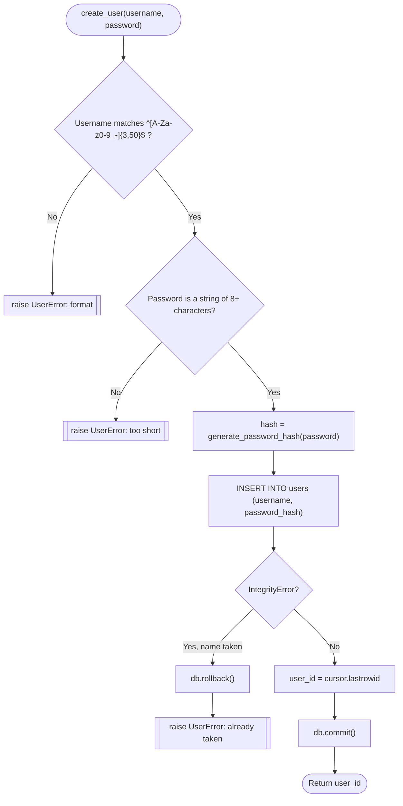
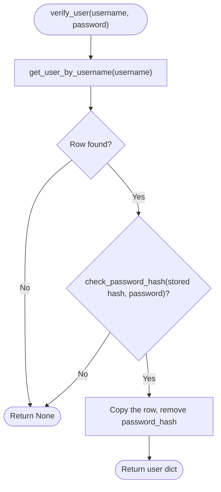

# Spec Sheet: Users (Accounts and Passwords)

| | |
|---|---|
| **Author** | Daniel S. |
| **Date** | 11/11/2026 |
| **Version** | V1.0 |
| **Jira** | URL-9 (user database). Used by URL-13 (login) and URL-12 (user swap) |
| **Files** | `app/users.py`, `users` table in `app/schema.sql` |
| **Tests** | `tests/test_users.py` |

## 1. Purpose

Creates accounts, looks them up, and checks a username and password at
login. Passwords are only ever stored as a werkzeug salted hash. There are
no routes in this file, the pages call these functions.

## 2. Inputs

| Input | Rule |
|---|---|
| `username` | String, 3 to 50 characters, only `A-Z a-z 0-9 _ -` (`USERNAME_PATTERN`) |
| `password` | String, at least 8 characters (`MIN_PASSWORD_LENGTH`), no upper limit |
| `user_id` | `users.id` integer |

## 3. Outputs

| Function | Output |
|---|---|
| `create_user` | new `users.id` |
| `get_user_by_username` | `{id, username, password_hash, created_at}` or `None` |
| `get_user_by_id` | `{id, username, created_at}` or `None` (no hash) |
| `verify_user` | `{id, username, created_at}` on a match, else `None` |

## 4. Behavior

* **Validation first.** `create_user` checks the username and password
  rules before touching MySQL and raises `UserError` with a message that is
  safe to show the user.
* **Duplicates are caught by MySQL.** The `UNIQUE` rule on
  `users.username` rejects a second account with the same name. The
  `IntegrityError` is turned into `UserError("Username 'x' is already
  taken.")` after a rollback. Doing it this way (instead of looking first)
  means two sign ups at the same moment can't both win.
* **No SQL injection.** Every query uses `%s` placeholders.
* **No hints at login.** `verify_user` returns `None` both for an unknown
  username and for a wrong password, so the login page can't reveal which.
* **Hash never leaves.** `verify_user` returns a copy with `password_hash`
  removed, and `get_user_by_id` never selects it.

## 5. Function Reference

| Function | Arg(s) | Returns | Raises |
|---|---|---|---|
| `validate_username(username)` | name typed | Nothing | `UserError` |
| `validate_password(password)` | password typed | Nothing | `UserError` |
| `create_user(username, password)` | name, plain password | new id | `UserError` (bad input or taken) |
| `get_user_by_username(username)` | name | row dict with hash, or `None` | |
| `get_user_by_id(user_id)` | id | row dict without hash, or `None` | |
| `verify_user(username, password)` | name, plain password | user dict without hash, or `None` | |

## 6. Flow Chart: `create_user`

## 7. Flow Chart: `verify_user`

## 8. Tests

* `tests/test_users.py` mocks `get_db()`. It checks every username and
  password rule, that the INSERT stores a hash (not the password), that a
  duplicate rolls back and raises `UserError`, both lookups, and that
  `verify_user` accepts the right password, rejects a wrong one or unknown
  user, and never returns the hash.
* Run: `python -m unittest tests.test_users -v`

## 9. Known Limits and Notes

* Username matching follows the column's collation, so `Dan` and `dan` are
  treated as the same name by MySQL's UNIQUE rule (default collation is
  case insensitive).
* No sign up or login page exists yet. Login is URL-13.
