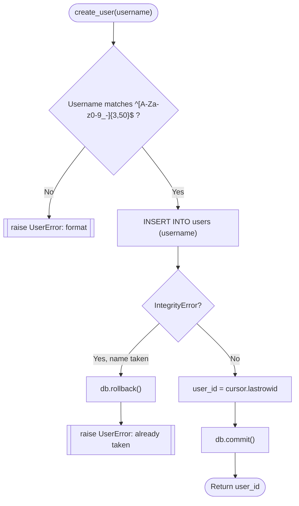
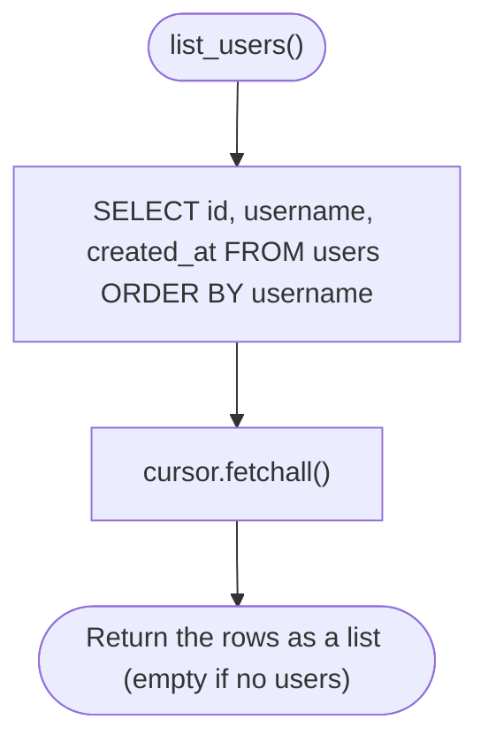

# Spec Sheet: Users (Usernames)

| | |
|---|---|
| **Author** | Daniel S. |
| **Date** | 11/11/2026 |
| **Version** | V1.1 |
| **Jira** | URL-9 (user database), URL-23 (passwords removed). Used by URL-13 (user picker) and URL-12 (user swap) |
| **Files** | `app/users.py`, `users` table in `app/schema.sql` |
| **Tests** | `tests/test_users.py` |

## 1. Purpose

Creates users, looks them up, and lists them all for the user picker. A
user is just a unique username. There are no passwords and no login check,
because the class only wants the ability to swap between users, not
authentication (URL-12, URL-23). There are no routes in this file, the pages
call these functions.

## 2. Inputs

| Input | Rule |
|---|---|
| `username` | String, 3 to 50 characters, only `A-Z a-z 0-9 _ -` (`USERNAME_PATTERN`) |
| `user_id` | `users.id` integer |

## 3. Outputs

| Function | Output |
|---|---|
| `create_user` | new `users.id` |
| `get_user_by_username` | `{id, username, created_at}` or `None` |
| `get_user_by_id` | `{id, username, created_at}` or `None` |
| `list_users` | list of `{id, username, created_at}`, sorted by username |

## 4. Behavior

* **Validation first.** `create_user` checks the username rule before
  touching MySQL and raises `UserError` with a message that is safe to show
  the user.
* **Duplicates are caught by MySQL.** The `UNIQUE` rule on
  `users.username` rejects a second user with the same name. The
  `IntegrityError` is turned into `UserError("Username 'x' is already
  taken.")` after a rollback. Doing it this way (instead of looking first)
  means two people adding the same name at the same moment can't both win.
* **No SQL injection.** Every query uses `%s` placeholders.
* **No passwords.** Nothing is hashed, stored or checked. Anyone using the
  site can pick any user. That is what the course asks for.
* **Listing is sorted.** `list_users` returns every user A to Z so the
  picker always shows them in the same order.

## 5. Function Reference

| Function | Arg(s) | Returns | Raises |
|---|---|---|---|
| `validate_username(username)` | name typed | Nothing | `UserError` |
| `create_user(username)` | name | new id | `UserError` (bad input or taken) |
| `get_user_by_username(username)` | name | row dict, or `None` | |
| `get_user_by_id(user_id)` | id | row dict, or `None` | |
| `list_users()` | none | list of row dicts (may be empty) | |

## 6. Flow Chart: `create_user`

## 7. Flow Chart: `list_users`

## 8. Tests

* `tests/test_users.py` mocks `get_db()`. It checks every username rule,
  that the INSERT sends only the username, that a duplicate rolls back and
  raises `UserError`, both lookups, and that `list_users` sorts by username
  and returns a plain list.
* Run: `python -m unittest tests.test_users -v`

## 9. Known Limits and Notes

* Username matching follows the column's collation, so `Dan` and `dan` are
  treated as the same name by MySQL's UNIQUE rule (default collation is
  case insensitive).
* No page for adding or picking a user exists yet. That is URL-13.
* The `users` table lost its `password_hash` column in URL-23. An existing
  database has to be rebuilt once, see the database spec sheet.
